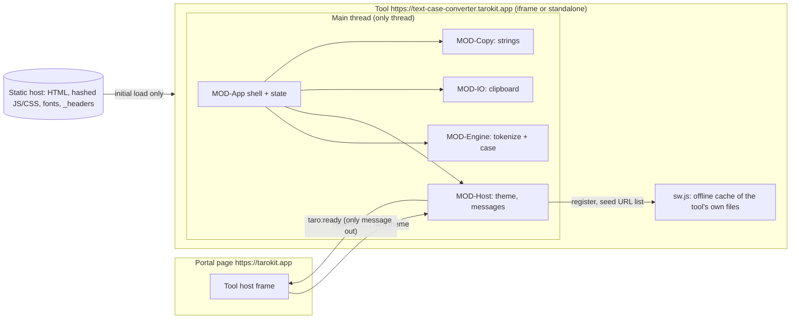

# Architecture

Status: proposed (2026-10-15). Decisions: ADR-0001 … ADR-0011. Modules: `modules/`.
Dependencies: `dependencies.md`. Platform details: `platform-mapping.md`.
Spikes applied: SPK-tokenizer, SPK-unicode (`.build-my-app/reports/spike-tokenizer.md`,
`spike-unicode.md`).

## Summary

A static single-page web app at `https://text-case-converter.tarokit.app`, embedded by the
taro-kit portal (`https://tarokit.app`) in a sandboxed iframe and fully usable standalone.
**Preact 10 + signals** render one screen (SCR-Converter): a plain `<textarea>` input and a live
grid of eleven result rows (ADR-0002, ADR-0005). An **in-house, dependency-free case engine**
(MOD-Engine) does all tokenization and casing **synchronously on the main thread**,
debounced ~150 ms; there is **no editor library and no worker** because the input is bounded by
the RULE-08 cap and the work is pure string transformation measured at ~55 ms for 100k characters
(ADR-0004, ADR-0005, SPK-tokenizer). Built with **TypeScript + Vite + pnpm** (ADR-0003), styled
with **plain CSS and the portal's tokens** (ADR-0007), hosted on **Cloudflare static assets** with
a header-delivered strict CSP (`connect-src 'none'`, `frame-ancestors https://tarokit.app`)
(ADR-0006), offline after one visit through a hand-written service worker (ADR-0010), tested with
**Vitest, fast-check, Playwright ×3 engines, axe, Lighthouse CI** (ADR-0009). Choices mirror the
sibling JSON Formatter wherever they fit; the engine and the absence of a worker are the only
material differences.

## Assumptions

- A1. Reference machine as defined at the top of `50-quality/nfr.md`.
- A2. Input is bounded by the RULE-08 cap (100,000 characters) for live conversion; larger input
  degrades gracefully (compute after settle) and is not optimised.
- A3. The portal frames the tool with `sandbox="allow-scripts allow-same-origin"`,
  `allow="clipboard-write"`, and passes the theme per the host contract (ADR-0008).
- A4. No backend, no accounts, no storage of any kind in M-1 (PRN-01). The offline service worker
  (ADR-0010, F-007) stores only the tool's own files.
- A5. English-only UI in M-1; conversion handles any Unicode input (ADR-0011).

## System context



After load, no arrow leaves the tool except `taro:ready` (INV-01, NFR-01; enforced by CSP
`connect-src 'none'`, a lint ban on network/storage APIs, and a request-log check in e2e). The
only allowed traffic after load is the browser's own fetch/update-check of the tool's own files
for the offline cache.

## Modules

| Module     | Responsibility (short)                                                | Main features / NFRs                                                     |
| ---------- | --------------------------------------------------------------------- | ------------------------------------------------------------------------ |
| MOD-Engine | Pure tokenizer + eleven case renders, per line                        | F-002, F-003 data, F-004; RULE-01/01b/02/03/04/05/06; INV-01..04; NFR-03 |
| MOD-App    | Preact shell, state, settle-debounced recompute, grid, status, notice | SCR-Converter, F-001, F-002, F-004, F-006; NFR-02, NFR-06, NFR-08        |
| MOD-Host   | Theme, origin-checked messages, ready signal, offline SW              | F-005, F-007; RULE-10; NFR-01, NFR-07                                    |
| MOD-IO     | Clipboard copy with failure reporting                                 | F-003; RULE-07                                                           |
| MOD-Copy   | Generated strings from copy.md                                        | copy.md                                                                  |
| MOD-Build  | Codegen, headers, size/license/corpus gates, deploy                   | NFR-01, NFR-03, NFR-05                                                   |

Dependency rule (lint-enforced): MOD-Engine imports nothing (no DOM, no deps); only MOD-App
imports Preact; nothing imports a network or storage API.

## Execution model

- **One thread.** Input → (settle ~150 ms, RULE-08) → MOD-Engine computes all eleven results →
  signals update the affected rows. No worker; SPK-tokenizer measured 11 cases on 100k chars at
  ~55 ms, well within NFR-02's 100 ms.
- **Cap behavior.** Past 100,000 characters, compute runs only after the input stops changing and
  COPY-notice.large is shown once per session (RULE-08); the UI never freezes.
- **Determinism.** No settings, no stored state; the same input always yields the same output
  (INV-02).

## Data flow

```mermaid
sequenceDiagram
  participant U as User
  participant A as MOD-App
  participant E as MOD-Engine
  participant IO as MOD-IO
  U->>A: type / paste (CMP-InputArea)
  A->>A: debounce ~150 ms (RULE-08)
  A->>E: convertAll(text)
  E->>A: eleven results (per line, RULE-03)
  A->>A: render CMP-ResultGrid rows; status line count
  U->>A: activate a row (copy)
  A->>IO: copy(result text)
  alt ok
    IO->>A: success → COPY-status.copied (announced)
  else refused
    IO->>A: failure → COPY-status.copy_failed via CMP-Notice (F-003.R5)
  end
```

## Budgets and baselines

### Startup (NFR-05: interactive ≤ 1.5 s cold at 10 Mbit/s & 40 ms RTT; ≤ 0.5 s cached)

No editor and no worker, so the critical path is small.

| Item (compressed)                                             | Budget      | Estimate  |
| ------------------------------------------------------------- | ----------- | --------- |
| HTML (incl. inline theme boot, inline SVG)                    | ≤ 8 KB      | ~5 KB     |
| CSS (tokens + base + components)                              | ≤ 12 KB     | ~8 KB     |
| JS: Preact + signals                                          | ≤ 10 KB     | ~8 KB     |
| JS: app shell + engine + host + IO + copy                     | ≤ 20 KB     | ~12 KB    |
| **Critical path total**                                       | **≤ 50 KB** | ~33 KB    |
| Fonts (2 variable WOFF2 Latin subsets, swap, non-blocking)    | ≤ 80 KB     | ~60–80 KB |
| Enforced by the build size gate and Lighthouse CI (ADR-0009). |

### Runtime targets (spike-derived)

| Measure                                           | Target                      | Source                         |
| ------------------------------------------------- | --------------------------- | ------------------------------ |
| All eleven cases on a cap-sized (100k char) input | ≤ 100 ms after settle       | NFR-02, SPK-tokenizer (~55 ms) |
| Engine correctness on the adversarial corpus      | 100%                        | NFR-03, SPK-tokenizer (46/46)  |
| Keystroke → visible feedback                      | ≤ 100 ms (settle-debounced) | NFR-02                         |
| Startup interactive (cold / cached)               | ≤ 1.5 s / ≤ 0.5 s           | NFR-05                         |
| Zero network requests after load                  | 0                           | NFR-01                         |

### Tunable constants (initial values)

Settle delay 150 ms; responsiveness cap 100,000 characters; `/sw.js` max-age 86,400 s.

## Risks (ranked) and how they are retired

1. **Tokenization exactness** (acronyms, numbers, Unicode) — retired by SPK-tokenizer (100% on the
   corpus); kept in check by the corpus + property tests (NFR-03).
2. **Locale/Unicode casing traps** — retired by SPK-unicode (locale-independent mapping; ADR-0011).
3. **Live-compute jank on large paste** — bounded by the RULE-08 cap + debounce; measured headroom.
4. **Iframe platform behavior** (theme without flash, clipboard, origin filtering, offline, CSP) —
   mirror the sibling's proven approach (ADR-0006, ADR-0008, ADR-0010); confirmed in the sibling's
   cross-engine spikes; a manual real-Safari pass remains for QA.

## Open items

- O-1 The exact style tile and token mapping are produced in the design phase (ADR-0007).
- O-2 Owner approval of the license policy (ADR-0001) and the runtime/asset dependency rows is a
  gate condition (legal).
