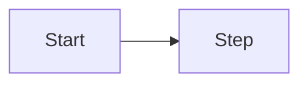

## Goal

<What the user achieves end to end.>

## Diagram

## Steps

1. <Step — screen — feature requirement it exercises>

## Exits & failures

- <Where the user can leave and what happens to their work>
